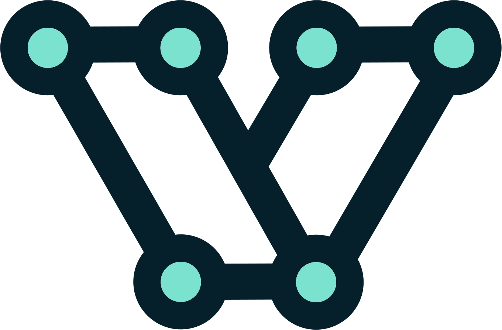

# QUAC

QUAC (Quite Useful Additions for Catalogs) is a profile of [STAC](https://stacspec.org) 1.1.0 that adds map layer settings to a catalogue, and the tools that write and read it: a QGIS plugin that writes a project's catalogue from QGIS Desktop and serves it from QGIS Server, and a JavaScript package that writes and reads it. [What this repository holds](#what-this-repository-holds) says where each is.

**What QUAC lets you know about a catalogue**

**Map**
- the layer to make active when it opens
- the view it opens on
- which layers start switched on
- groups that show one layer at a time

**Layers**
- read-only layers, and locked edits: adding, changing, moving, deleting
- private layers, such as lookup tables to keep out of a layer list
- related layers, such as inspections that belong to a site
- the field that names each feature in a list
- scale range and opacity

**Fields**
- choices from a fixed list or from another layer
- number ranges, steps and units
- date formats and checkbox values
- required and unique fields, and rules with their messages
- default values, and fields that keep the last value entered
- fields that can't be changed, or only while a condition holds

**Forms**
- field order
- fields shown only while a condition holds, such as "Cause of damage" once "Damaged" is ticked

**Sources**
- QGIS projects and QGIS Server, WFS, WMS, OGC API Features and ArcGIS

## Where QUAC fits

A STAC catalogue says what data exists, where it is and how to read it, and [Portolan](https://github.com/portolan-sdi/portolan-spec) says how to publish one for cloud-native data with no server to run.

A catalogue does not say how a map should show that data or how people should edit it. That lives in a QGIS project, a GIS server's configuration or an ArcGIS Web Map, each in a format mostly read only by the software that wrote it.

QUAC puts it in the catalogue, beside the data. A QUAC Collection is an ordinary STAC Collection with `quac:` fields added.

- A Portolan catalogue with QUAC fields tells an application how to show each layer and what its form holds. [QUAC and Portolan](#quac-and-portolan) says how the two fit.
- The fields for forms, rules, relations and styles are the same for a GeoParquet file, a QGIS Server or WFS layer and an ArcGIS Feature Service. Only a field that says where the data is, such as `quac:wfs_endpoint`, belongs to one kind of source.
- A field that carries a setting QGIS, QField, Mergin Maps or an ArcGIS client already acts on is marked stable in the spec. A field that only one application gives meaning to is marked experimental.
- Every field is optional, so an application can read the fields it knows and ignore the rest. A missing field means the source said nothing.

## QUAC and Portolan

Portolan sets the conventions a reader of a cloud-native catalogue relies on. QUAC follows them where they apply:

- **Data and tiles.** QUAC finds a layer's data by the asset's `data` role, and reads PMTiles from a `rel: "pmtiles"` link or a `visual` asset, the two places Portolan registers them.
- **Styles.** A style is a Collection asset with the `style` role, and the default style also carries the `default` role, as Portolan's core specification sets out.
- **Fields.** Portolan describes a dataset's columns with the [Table extension](https://github.com/stac-extensions/table)'s `table:columns`. QUAC's settings for a field sit on that field's entry.

[Portolan's core specification](https://github.com/portolan-sdi/portolan-spec/blob/main/specs/portolan/core.md) has no fields for forms, field rules, edit locks or relations between layers. QUAC adds them under the `quac:` prefix and leaves Portolan's fields as they are.

## One Collection at a time

The package writes a catalogue as one document, with each Catalog carrying its Collections inline. It also writes a `rel: "child"` link to where each Collection would sit as a file of its own, `./collections/<id>.json`, which is how a Portolan catalogue is laid out, and `splitCatalogue` writes the catalogue as those separate documents, each with the path to save it at. [The demo](#try-it) is published both ways.

An application can read QUAC one Collection at a time, as a STAC client opens it:

- **A layer's settings are all on its Collection**: its form and field rules on the Collection's `table:columns`, and its locks, relations, display field and style on the Collection itself. The package's `readCollection…` functions each take one Collection ([the package's README](packages/quac/README.md#read-a-collection) has an example).
- **A field that names another layer names its Collection id**, such as a Value Relation's list of choices or a child layer's parent. Reading those choices or records means opening that Collection too.
- **The map's own settings are on the top-level Catalog**: the layer to make active, the view the map opens on, and a service's address. A group's settings are on its Catalog.

## What QUAC adds to a field

Two entries from a street-tree layer's `table:columns`, taken from [the example catalogue that carries every field](packages/quac/src/schema/examples/every-field.json). `name` and `type` are the Table extension's; the rest are QUAC's.

```json
[
  {
    "name": "species",
    "quac:control": "buttons",
    "quac:value_relation": {
      "collection": "species",
      "key": "code",
      "value": "common_name",
      "filter": "\"in_use\" = 1",
      "allow_null": true,
      "order_by": "field",
      "order_field": "sort_order",
      "descending": true
    }
  },
  {
    "name": "height",
    "type": "double",
    "quac:range": {
      "min": 0,
      "max": 80,
      "step": 0.5,
      "precision": 1,
      "suffix": " m"
    },
    "quac:constraints": {
      "not_null": "warn",
      "expression": {
        "expression": "\"height\" < 80",
        "description": "Taller than any tree in the city",
        "strength": "warn"
      }
    }
  }
]
```

The species field offers its choices as buttons, taken from the `species` layer of the same catalogue: it stores a species' `code` and shows its `common_name`. The height field takes a number from 0 to 80 metres, and a form warns when it is left blank or is 80 or more. The [field reference](packages/quac/spec/README.md) describes every field.

## From a QGIS setting to a QUAC field

Each setting below has an example under [`packages/quac/spec/examples/`](packages/quac/spec/examples/): a small QGIS project holding that one setting, the catalogue it gives, and a README naming the setting in QGIS's own words. An application that reads QGIS projects itself can open each `project.qgs` and check what it reads against the README, whether or not it reads QUAC.

**Attributes Form**, in a layer's Layer Properties:

| QGIS setting | QUAC field | Example |
|---|---|---|
| Alias | the column's `title` | |
| Comment (QGIS 4.2 and later) | the column's `description` | |
| Label on top | `quac:label_on_top` | [label-on-top](packages/quac/spec/examples/label-on-top/) |
| Value Map widget | `quac:values` | [value-map](packages/quac/spec/examples/value-map/) |
| Value Relation widget | `quac:value_relation` | [value-relation](packages/quac/spec/examples/value-relation/) |
| Range widget | `quac:range` | [range](packages/quac/spec/examples/range/) |
| Checkbox widget | `quac:checkbox` | [checkbox](packages/quac/spec/examples/checkbox/) |
| Date/Time widget | `quac:date_format` | [date-format](packages/quac/spec/examples/date-format/) |
| Attachment widget | `quac:attachment` | [attachment](packages/quac/spec/examples/attachment/) |
| Color widget | `quac:color` | [color](packages/quac/spec/examples/color/) |
| Hidden widget | `quac:hidden` | [hidden](packages/quac/spec/examples/hidden/) |
| UUID Generator widget | `quac:editable` and `quac:default` | |
| Constraints | `quac:constraints` | [constraints](packages/quac/spec/examples/constraints/), [constraint-expression](packages/quac/spec/examples/constraint-expression/) |
| Default value | `quac:default` | [default](packages/quac/spec/examples/default/) |
| Editable, unticked | `quac:editable` | [column-editable](packages/quac/spec/examples/column-editable/) |
| Reuse Last Entered Value | `quac:reuse_last_value` | [reuse-last-value](packages/quac/spec/examples/reuse-last-value/) |
| Duplicate policy | `quac:duplicate_policy` | [duplicate-policy](packages/quac/spec/examples/duplicate-policy/) |
| Drag and Drop Designer: the fields placed, in order | `quac:form_order` and `quac:in_form` | [form-order](packages/quac/spec/examples/form-order/) |
| Drag and Drop Designer: a container's visibility expression | `quac:visible_when` | [visible-when](packages/quac/spec/examples/visible-when/) |
| Drag and Drop Designer: a field's data-defined Editable | `quac:editable_when` | [editable-when](packages/quac/spec/examples/editable-when/) |

**The rest of Layer Properties**, and the Layers panel:

| QGIS setting | QUAC field | Example |
|---|---|---|
| Fields tab: Not searchable | `quac:searchable` | [searchable](packages/quac/spec/examples/searchable/) |
| Display tab: Display Name | `quac:display_field` | [display-field](packages/quac/spec/examples/display-field/) |
| Symbology tab: a Categorized style | `quac:categorised_field` | [categorised-field](packages/quac/spec/examples/categorised-field/) |
| Symbology tab: Opacity | `quac:opacity` | [opacity](packages/quac/spec/examples/opacity/) |
| Rendering tab: Scale Dependent Visibility | `quac:min_scale` and `quac:max_scale` | [scale-range](packages/quac/spec/examples/scale-range/) |
| Legend tab: Legend placeholder image | `quac:legend_image` | [legend-image](packages/quac/spec/examples/legend-image/) |
| Source tab: Provider Feature Filter | `quac:feature_filter` | [feature-filter](packages/quac/spec/examples/feature-filter/) |
| The layer's kind of geometry | `quac:geometry_type` | [geometry-type](packages/quac/spec/examples/geometry-type/) |
| A layer per geometry type, from a file holding several | `quac:geometry_filter` | [geometry-filter](packages/quac/spec/examples/geometry-filter/) |
| A table chosen from a GeoPackage | `quac:layer_name` | [layer-name](packages/quac/spec/examples/layer-name/) |
| A Delimited Text layer | `quac:delimited_text` | [delimited-text](packages/quac/spec/examples/delimited-text/) |
| A WFS layer's CRS | `quac:wfs_srs_name` | [qgis-wfs-layer](packages/quac/spec/examples/qgis-wfs-layer/) |
| A WMS layer's CRS and version | `quac:wms_crs` and `quac:wms_version` | [wms-link](packages/quac/spec/examples/wms-link/) |
| A WMTS layer's tile matrix set and style | `quac:wmts_tile_matrix_set` and `quac:wmts_style` | [wmts-link](packages/quac/spec/examples/wmts-link/) |
| An XYZ connection's Max. Zoom Level | `quac:max_zoom` | [max-zoom](packages/quac/spec/examples/max-zoom/) |
| Layers panel: the layer's tick | `quac:visibility_checked` | [layer-visibility](packages/quac/spec/examples/layer-visibility/) |
| Layers panel: Mutually Exclusive Group | `quac:mutually_exclusive` | [mutually-exclusive](packages/quac/spec/examples/mutually-exclusive/) |

**Project Properties**:

| QGIS setting | QUAC field | Example |
|---|---|---|
| Relations | `quac:related_to` | [related-to](packages/quac/spec/examples/related-to/) |
| Data Sources: Read-only | `quac:editable` | [editable](packages/quac/spec/examples/editable/) |
| Data Sources: Identifiable | `quac:identifiable` | [identifiable](packages/quac/spec/examples/identifiable/) |
| Data Sources: Private | `quac:private` | [private](packages/quac/spec/examples/private/) |
| General: units for area and distance | `quac:measurement` | [measurement](packages/quac/spec/examples/measurement/) |
| The map view saved with the project | `quac:initial_view` | [initial-view](packages/quac/spec/examples/initial-view/) |
| QGIS Server: a layer's published names | `quac:qgis_server_wms_name` and `quac:qgis_server_wfs_type_name` | [server-names](packages/quac/spec/examples/server-names/) |
| QGIS Server: WMS CRS restrictions | `quac:wms_crs` | [server-wms-crs](packages/quac/spec/examples/server-wms-crs/) |
| Layout Manager: the print layouts, less those under QGIS Server's Exclude layouts | `quac:print_layouts` | [print-layouts](packages/quac/spec/examples/print-layouts/) |

**The field apps' QGIS plugins**, which save their settings in the project:

| Setting | QUAC field | Example |
|---|---|---|
| QFieldSync: Initial active layer | `quac:active_collection` | [active-collection](packages/quac/spec/examples/active-collection/) |
| QFieldSync: Disable feature addition, attribute editing, geometry editing or deletion | `quac:locks` | [locks](packages/quac/spec/examples/locks/) |
| Mergin Maps: filters | `quac:filters` | [filters](packages/quac/spec/examples/filters/) |

**QUAC's own layer variables**, for what QGIS has no setting for:

| Variable | QUAC field | Example |
|---|---|---|
| `quac_icon`, for the layer | `quac:icon` | [layer-icon](packages/quac/spec/examples/layer-icon/) |
| `quac_icon_<field>`, for a field | `quac:icon` | [column-icon](packages/quac/spec/examples/column-icon/) and [icon-other-library](packages/quac/spec/examples/icon-other-library/) |
| `quac_control_<field>`, buttons or a dropdown | `quac:control` | [control](packages/quac/spec/examples/control/) |
| `quac_added_message`, the message once a feature is added | `quac:added_message` | [added-message](packages/quac/spec/examples/added-message/) |

**The layer's data**, as QGIS opens it, which the project file does not hold. The QUAC plugin writes these, and QGIS Server's GetProjectSettings reports all but a field's default:

| What the data defines | QUAC field | Example |
|---|---|---|
| A field's comment, such as a PostgreSQL column comment | the column's `description` | |
| The layer's primary key, a field's length and precision, and a default the data source states for a field | `quac:primary_key`, `quac:length`, `quac:precision` and `quac:filled_by_data` | [field-facts](packages/quac/spec/examples/field-facts/) |

The [field reference](packages/quac/spec/README.md) gives each field's full shape, and the fields that other sources, such as WFS and ArcGIS, write.

## Try it

The site publishes [a small made-up catalogue](https://vectoriahq.github.io/quac/demo/catalog.json) of street trees, their species and their inspections, from the QGIS project beside it. A STAC client can open it from that address. Its [README](site/demo/README.md) lists what each field of the trees layer shows.

## What QUAC leaves out

QUAC says what an edit may do: which fields can be changed, what each accepts, and which edits are locked. It does not say how an edit is saved. That is left to the application and the source, such as a WFS-T service or a file the application can write to.

The JavaScript package makes no network request. It builds a catalogue from what an application has already fetched, such as a QGIS project's text or a QGIS Server GetProjectSettings response, and reads a catalogue it is given.

## Checking a catalogue

The schema is [`packages/quac/src/schema/quac.schema.json`](packages/quac/src/schema/quac.schema.json), a JSON Schema (draft-07) whose `$id` is `https://vectoriahq.github.io/quac/v0.3.0/schema.json`. Any draft-07 validator checks a Catalog with its Collections inline, or a single Collection, against it. It checks only `quac:` fields: any other field passes, and a `quac:` field the schema does not define fails. A catalogue says it follows QUAC by listing the schema's address in `stac_extensions`.

## What this repository holds

- **The spec**, the field reference and its per-field examples: [`packages/quac/spec/`](packages/quac/spec/).
- **The JavaScript package**, `@vectoriahq/quac`, which writes QUAC catalogues from QGIS projects and other sources and reads them back: [`packages/quac/`](packages/quac/).
- **The QGIS plugin**, which serves a project's QUAC catalogue from QGIS Server at `SERVICE=QUAC&REQUEST=GetCatalogue&MAP=<project>`, and in QGIS Desktop writes it into a chosen folder as STAC documents each time the project is saved, with the Python port of the JavaScript reader it is built on: [`packages/quac-qgis-server/`](packages/quac-qgis-server/). It is in the QGIS plugin repository as [QUAC](https://plugins.qgis.org/plugins/quac/).
- **The site's front page and the demo catalogue**, published at [`https://vectoriahq.github.io/quac/`](https://vectoriahq.github.io/quac/): [`site/`](site/).

## Implementations

| Implementation | Writes | Reads |
|---|---|---|
| [`@vectoriahq/quac`](packages/quac/), JavaScript | from QGIS projects, QGIS Server, WFS, OGC API Features, ArcGIS, and folders and files of data | each Collection's settings |
| [QUAC for QGIS Server and QGIS Desktop](packages/quac-qgis-server/), a QGIS plugin in Python | from a project QGIS Server publishes, or a project saved in QGIS Desktop | |
| Groundwork, Vectoria's web app | through `@vectoriahq/quac` | every map it opens, through `@vectoriahq/quac` |

An application that reads or writes QUAC can be listed here: [open an issue](https://github.com/vectoriahq/quac/issues) naming it.

## Where QUAC came from

QUAC began inside Groundwork, Vectoria's web app for capturing and editing spatial data. Groundwork reads each source a map connects to, from a QGIS project to an ArcGIS Web Map or a STAC catalogue, as a STAC catalogue, and QUAC holds what STAC has no field for. Groundwork is QUAC's first reader, which is why the spec marks a field experimental where Groundwork alone gives it meaning.

## Status

QUAC is pre-1.0. The JavaScript package is on npm as [`@vectoriahq/quac`](https://www.npmjs.com/package/@vectoriahq/quac), and the QGIS plugin is in the QGIS plugin repository as [QUAC](https://plugins.qgis.org/plugins/quac/).

## Licence

Copyright 2026 Vectoria Pty Ltd.

- **The spec, the schema, the examples and the JavaScript package** are under the [Apache License 2.0](LICENSE), the licence of the STAC specification and its extension template.
- **The QGIS Server plugin**, `packages/quac-qgis-server/`, is under the [GNU General Public License, version 2 or any later version](packages/quac-qgis-server/LICENSE), as the QGIS plugin repository asks of a plugin.

## Made by Vectoria

<a href="https://vectoria.com.au"><picture><source media="(prefers-color-scheme: dark)" srcset="assets/vectoria-logo-dark.svg"></picture></a>

[vectoria.com.au](https://vectoria.com.au)
