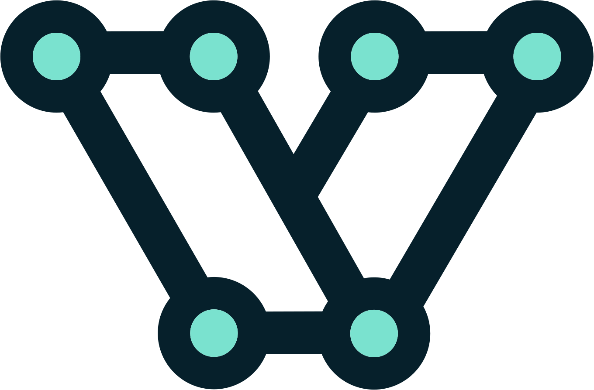

# QUAC

QUAC (Quite Useful Additions for Catalogs) is a profile of [STAC](https://stacspec.org) 1.1.0 that adds map layer settings to a catalogue.

**What QUAC lets you know about a catalogue**

**Map**
- the layer to make active when it opens
- the view it opens on
- which layers start switched on
- groups that show one layer at a time

**Layers**
- read-only layers, and locked edits: adding, changing, moving, deleting
- private layers, such as lookup tables to keep out of a layer list
- related layers, such as inspections that belong to a site
- the field that names each feature in a list
- scale range and opacity

**Fields**
- choices from a fixed list or from another layer
- number ranges, steps and units
- date formats and checkbox values
- required and unique fields, and rules with their messages
- default values, and fields that keep the last value entered
- fields that can't be changed, or only while a condition holds

**Forms**
- field order
- fields shown only while a condition holds, such as "Cause of damage" once "Damaged" is ticked

**Sources**
- QGIS projects and QGIS Server, WFS, WMS, OGC API Features and ArcGIS

## Where QUAC fits

A STAC catalogue says what data exists, where it is and how to read it, and [Portolan](https://github.com/portolan-sdi/portolan-spec) says how to publish one for cloud-native data with no server to run.

A catalogue does not say how a map should show that data or how people should edit it. That lives in a QGIS project, a GIS server's configuration or an ArcGIS Web Map, each in a format mostly read only by the software that wrote it.

QUAC puts it in the catalogue, beside the data. A QUAC Collection is an ordinary STAC Collection with `quac:` fields added.

- A Portolan catalogue with QUAC fields tells an application how to show each layer and what its form holds. [QUAC and Portolan](#quac-and-portolan) says how the two fit.
- The fields for forms, rules, relations and styles are the same for a GeoParquet file, a QGIS Server or WFS layer and an ArcGIS Feature Service. Only a field that says where the data is, such as `quac:wfs_endpoint`, belongs to one kind of source.
- A field that carries a setting QGIS, QField, Mergin Maps or an ArcGIS client already acts on is marked stable in the spec. A field that only one application gives meaning to is marked experimental.
- Every field is optional, so an application can read the fields it knows and ignore the rest. A missing field means the source said nothing.

## QUAC and Portolan

Portolan sets the conventions a reader of a cloud-native catalogue relies on. QUAC follows them where they apply:

- **Data and tiles.** QUAC finds a layer's data by the asset's `data` role, and reads PMTiles from a `rel: "pmtiles"` link or a `visual` asset, the two places Portolan registers them.
- **Styles.** A style is a Collection asset with the `style` role, and the default style also carries the `default` role, as Portolan's core specification sets out.
- **Fields.** Portolan describes a dataset's columns with the [Table extension](https://github.com/stac-extensions/table)'s `table:columns`. QUAC's settings for a field sit on that field's entry.

[Portolan's core specification](https://github.com/portolan-sdi/portolan-spec/blob/main/specs/portolan/core.md) has no fields for forms, field rules, edit locks or relations between layers. QUAC adds them under the `quac:` prefix and leaves Portolan's fields as they are.

A Portolan catalogue keeps each Collection in a file of its own, linked with `rel: "child"`. A QUAC catalogue is one document, with each Catalog carrying its Collections inline. The package reads the one-document form. An application reading a catalogue split across files gathers it into one document first.

## What QUAC adds to a field

Two entries from a street-tree layer's `table:columns`, taken from [the example catalogue that carries every field](packages/quac/src/schema/examples/every-field.json). `name` and `type` are the Table extension's; the rest are QUAC's.

```json
[
  {
    "name": "species",
    "quac:control": "buttons",
    "quac:value_relation": {
      "collection": "species",
      "key": "code",
      "value": "common_name",
      "filter": "\"in_use\" = 1",
      "allow_null": true,
      "order_by": "field",
      "order_field": "sort_order",
      "descending": true
    }
  },
  {
    "name": "height",
    "type": "double",
    "quac:range": {
      "min": 0,
      "max": 80,
      "step": 0.5,
      "precision": 1,
      "suffix": " m"
    },
    "quac:constraints": {
      "not_null": "warn",
      "expression": {
        "expression": "\"height\" < 80",
        "description": "Taller than any tree in the city",
        "strength": "warn"
      }
    }
  }
]
```

The species field offers its choices as buttons, taken from the `species` layer of the same catalogue: it stores a species' `code` and shows its `common_name`. The height field takes a number from 0 to 80 metres, and a form warns when it is left blank or is 80 or more. The [field reference](packages/quac/spec/README.md) describes every field.

## What QUAC leaves out

QUAC says what an edit may do: which fields can be changed, what each accepts, and which edits are locked. It does not say how an edit is saved. That is left to the application and the source, such as a WFS-T service or a file the application can write to.

The JavaScript package makes no network request. It builds a catalogue from what an application has already fetched, such as a QGIS project's text or a QGIS Server GetProjectSettings response, and reads a catalogue it is given.

## Checking a catalogue

The schema is [`packages/quac/src/schema/quac.schema.json`](packages/quac/src/schema/quac.schema.json), a JSON Schema (draft-07) whose `$id` is `https://vectoriahq.github.io/quac/v0.2.0/schema.json`. Any draft-07 validator checks a Catalog with its Collections inline, or a single Collection, against it. It checks only `quac:` fields: any other field passes, and a `quac:` field the schema does not define fails. A catalogue says it follows QUAC by listing the schema's address in `stac_extensions`.

## What this repository holds

- **The spec**, the field reference and its per-field examples: [`packages/quac/spec/`](packages/quac/spec/).
- **The JavaScript package**, `@vectoriahq/quac`, which writes QUAC catalogues from QGIS projects and other sources and reads them back: [`packages/quac/`](packages/quac/).
- **The QGIS Server plugin**, which serves a project's QUAC catalogue from QGIS Server at `SERVICE=QUAC&REQUEST=GetCatalogue&MAP=<project>`, with the Python port of the JavaScript reader it is built on: [`packages/quac-qgis-server/`](packages/quac-qgis-server/).

## Where QUAC came from

QUAC began inside Groundwork, Vectoria's web app for capturing and editing spatial data. Groundwork reads each source a map connects to, from a QGIS project to an ArcGIS Web Map or a STAC catalogue, as a STAC catalogue, and QUAC holds what STAC has no field for. Groundwork is QUAC's first reader, which is why the spec marks a field experimental where Groundwork alone gives it meaning.

## Status

QUAC is pre-1.0. Version 0.1.0 of the JavaScript package is on npm as [`@vectoriahq/quac`](https://www.npmjs.com/package/@vectoriahq/quac). The QGIS Server plugin is not yet released.

## Licence

Copyright 2026 Vectoria Pty Ltd.

- **The spec, the schema, the examples and the JavaScript package** are under the [Apache License 2.0](LICENSE), the licence of the STAC specification and its extension template.
- **The QGIS Server plugin**, `packages/quac-qgis-server/`, is under the [GNU General Public License, version 2 or any later version](packages/quac-qgis-server/LICENSE), as the QGIS plugin repository asks of a plugin.

## Made by Vectoria

<a href="https://vectoria.com.au"><picture><source media="(prefers-color-scheme: dark)" srcset="assets/vectoria-logo-dark.svg"></picture></a>

[vectoria.com.au](https://vectoria.com.au)
